# API REST de Series - Spring Boot
**Desarrollado por:**  `Fernando Lema Naula`

**Paralelo:** `3`

**Carrera:** `Desarrollo de Software`

Práctica obligatoria de desarrollo de una API REST completa para gestionar un catálogo de series de TV, implementando operaciones CRUD (Crear, Leer, Actualizar y Borrar) utilizando Spring Boot, Spring Data JPA, Lombok y base de datos en memoria H2.

---

## Tecnologías Utilizadas
* **Java:** 17
* **Framework:** Spring Boot
* **Base de Datos:** H2 Database (En memoria)
* **Utilidades:** Lombok
* **Gestor de Dependencias:** Maven

---

## Estructura del Proyecto
El proyecto sigue la arquitectura en capas solicitada en las especificaciones:

```text
demo1/
├── capturas/                                    # Evidencias de pruebas en Postman y H2
├── src/
│   ├── main/
│   │   ├── java/com/tarea01ferle/demo1/
│   │   │   ├── controller/
│   │   │   │   └── SerieController.java         # Controlador REST (/api/series)
│   │   │   ├── service/
│   │   │   │   └── SerieService.java            # Lógica de negocio
│   │   │   ├── repository/
│   │   │   │   └── SerieRepository.java         # Repositorio JPA
│   │   │   ├── models/
│   │   │   │   └── Serie.java                   # Entidad JPA + Lombok
│   │   │   └── Demo1Application.java            # Clase principal de ejecución
│   │   └── resources/
│   │       └── application.properties           # Configuración del puerto 9090 y H2
├── Series_API.postman_collection.json           # Colección de Postman exportada
├── pom.xml                                      # Dependencias de Maven
└── README.md                                    # Documentación del proyecto
```

---

## Instrucciones de Ejecución

1. **Clonar el repositorio:**
   ```bash
   git clone <REEMPLAZAR_CON_LA_URL_DE_TU_REPOSITORIO>
   cd demo1
   ```

2. **Ejecutar el proyecto:**
   Puedes iniciarlo ejecutando la clase `Demo1Application.java` desde **IntelliJ IDEA** o desde la terminal en la raíz del proyecto:
   * En Windows (PowerShell / CMD):
     ```powershell
     .\mvnw.cmd spring-boot:run
     ```
   * En Linux / macOS:
     ```bash
     ./mvnw spring-boot:run
     ```

3. **Accesos de la aplicación (Puerto 9090):**
   * **URL Base de los Endpoints:** `http://localhost:9090/api/series`
   * **Consola de Base de Datos H2:** `http://localhost:9090/h2-console`
     * **JDBC URL:** `jdbc:h2:mem:seriesdb`
     * **User Name:** `sa`
     * **Password:** *(dejar en blanco)*

---

## Especificación de la Entidad `Serie`

| Campo | Tipo | Descripción |
| :--- | :--- | :--- |
| `id` | `Long` | Identificador único (autogenerado) |
| `titulo` | `String` | Nombre de la serie |
| `plataforma` | `String` | Netflix, HBO, Prime, Disney+, etc. |
| `calificacion` | `Double` | Calificación del 1 al 10 |

---

## Endpoints Requeridos (Operaciones CRUD)

| Método HTTP | URL | Descripción | Código de Éxito |
| :--- | :--- | :--- | :--- |
| `GET` | `/api/series` | Listar todas las series | `200 OK` |
| `GET` | `/api/series/{id}` | Buscar una serie por su ID | `200 OK` / `404 Not Found` |
| `POST` | `/api/series` | Crear una nueva serie | `201 Created` / `400 Bad Request` |
| `PUT` | `/api/series/{id}` | Actualizar una serie existente | `200 OK` / `404 Not Found` |
| `DELETE` | `/api/series/{id}` | Eliminar una serie | `204 No Content` / `404 Not Found` |

### Ejemplo de JSON para `POST` y `PUT`:
```json
{
  "titulo": "Breaking Bad",
  "plataforma": "Netflix",
  "calificacion": 9.8
}
```

---

## Evidencias de Pruebas

### 1. Crear una nueva serie (`POST /api/series`)
Se envía el objeto JSON y la API responde con estado `201 Created` asignando el `id` autogenerado:
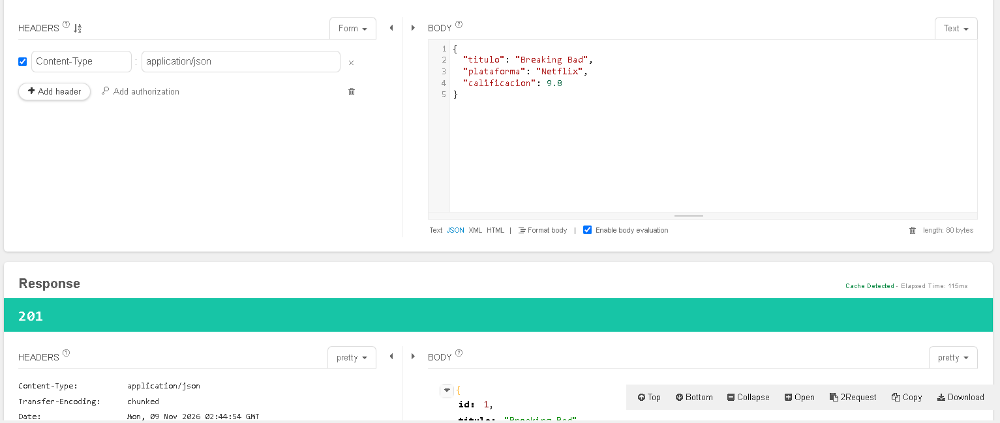
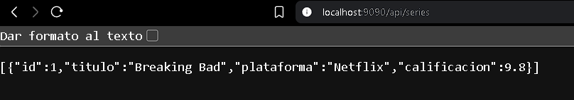

<br>

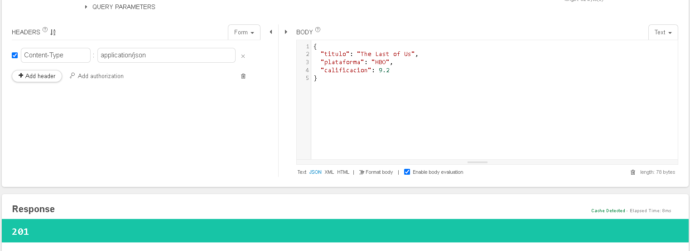
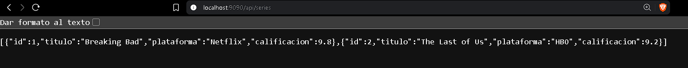

### 2. Listar todas las series (`GET /api/series`)
Retorna estado `200 OK` con el listado completo de series registradas:
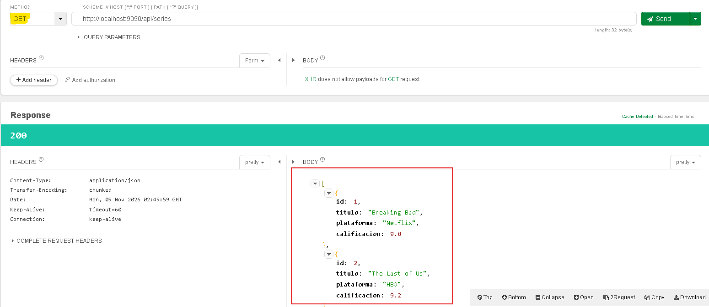

### 3. Buscar una serie por su ID (`GET /api/series/1`)
Retorna estado `200 OK` con los datos de la serie solicitada:
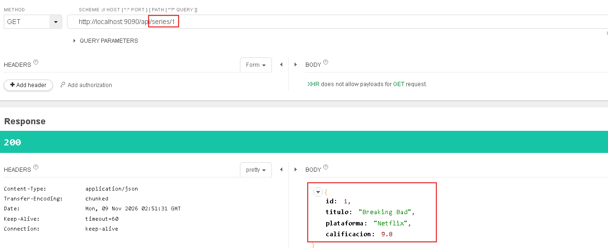
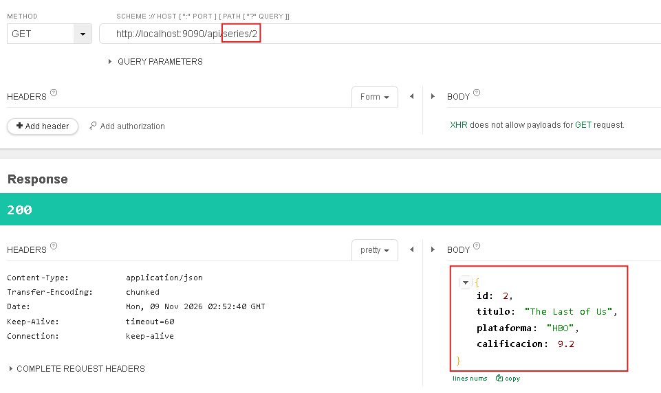

### 4. Actualizar una serie existente (`PUT /api/series/1`)
Actualiza los datos de la serie con ID `1` y retorna estado `200 OK`:
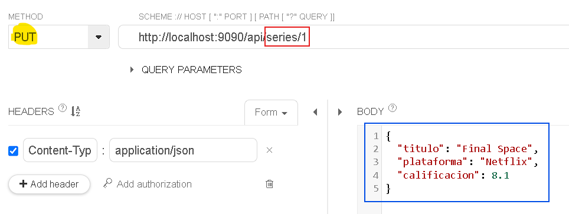
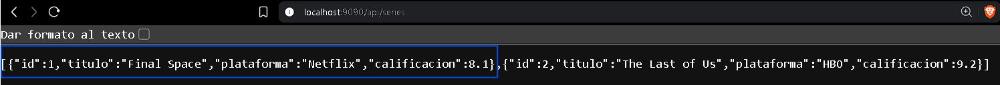

### 5. Eliminar una serie existente (`DELETE /api/series/1`)
Elimina los datos de la serie con ID `2` y retorna estado `204`:
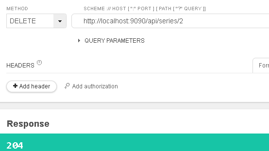
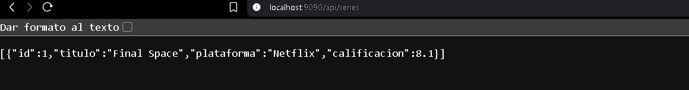

### 6. Pruebas de Casos Inexistentes
* **Caso A — Buscar un ID que no existe (`GET /api/series/3`):** Retorna estado `404 Not Found`.
  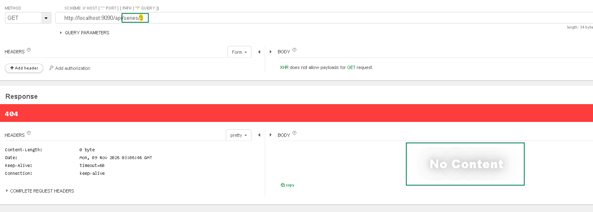

* **Caso B — Enviar datos inválidos (`POST /api/series` con calificación fuera del rango 1 a 10):** Retorna estado `400 Bad Request` con mensaje de validación.
  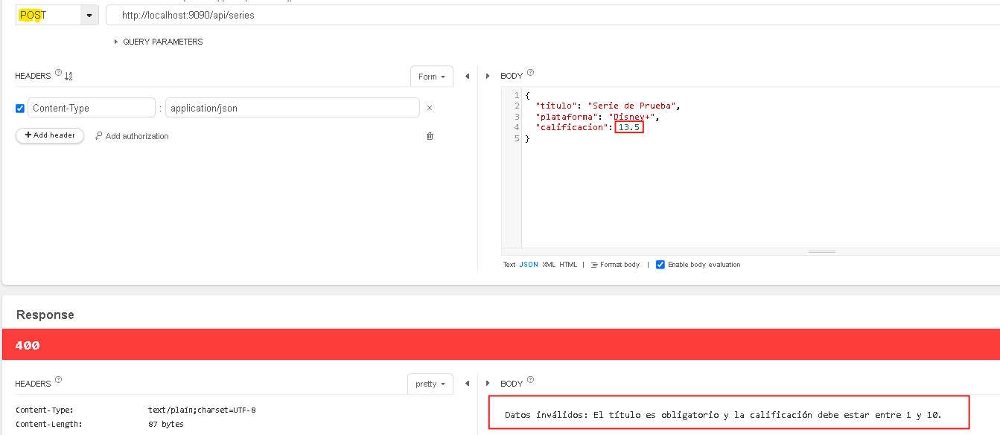
